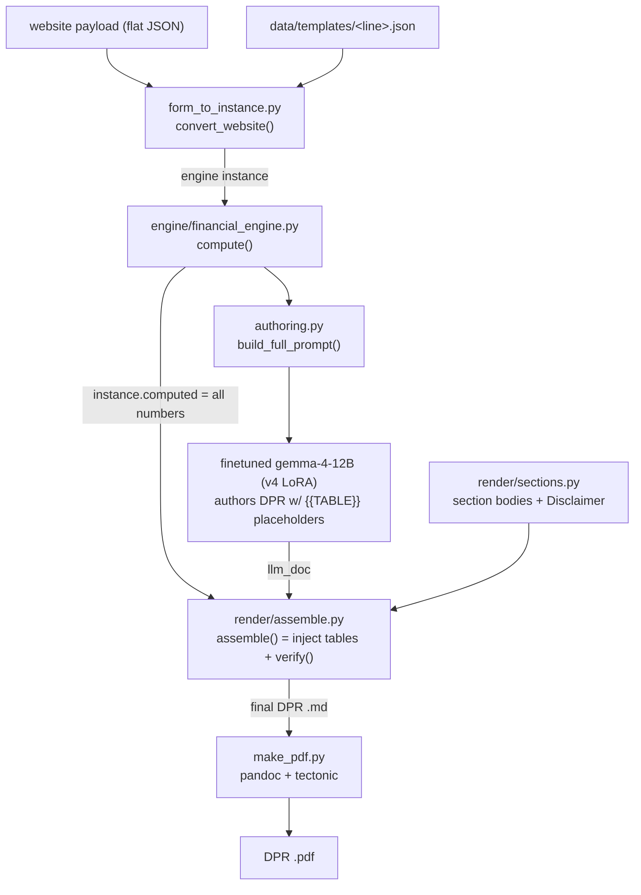
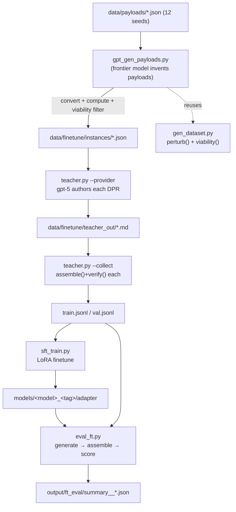

# File Flow — what each `.py` does and how they chain

How the code fits together, file by file. Two pipelines share one deterministic core:
**A. Production** (a form submission → a finished DPR) and **B. Training** (build data →
finetune → evaluate). See also [flow.md](flow.md) (conceptual request trace),
[CONFIG_REFERENCE.md](CONFIG_REFERENCE.md) (where every value comes from).

---

## A. Production pipeline — form → DPR

**Step by step:**
1. **`form_to_instance.py`** — `convert(payload)` dispatches to `convert_website()` (flat NAFPO payload) or `convert_nested()` (internal). Loads the business-line **template** for technical norms, maps every form field, applies defaults (`LINE_DEFAULTS`), and emits an **engine instance** (`meta / narrative / inputs / config / computed={}`).
2. **`engine/financial_engine.py`** — `compute(instance)` runs the whole 5-year financial model and fills `instance["computed"]` (project cost, means of finance, loan schedule, working capital, depreciation, P&L, break-even, DSCR). Pulls scheme rules from **`engine/scheme_norms.py`**. Asserts *means of finance == total project cost*.
3. **`authoring.py` → `build_full_prompt(instance)`** — builds the prompt (product facts + section structure + the list of `{{TABLE:id}}` placeholders) the model must fill.
4. **Model (v4 LoRA)** — authors the full DPR: headings + §2 narrative + placeholders, **no numbers**.
5. **`render/assemble.py`** — `assemble(llm_doc, instance)` injects the exact engine section bodies (from **`render/sections.py`**) into the placeholders, appends the **Disclaimer**, and runs `verify()` to flag any number the model typed that ≠ an engine value.
6. **`make_pdf.py`** *(optional)* — renders the DPR markdown → **PDF** with pandoc + tectonic (TOC after the summary, TikZ process-flow chart, booktabs tables) using the styles in `pdf/`.

---

## B. Training pipeline — data → finetune → eval

**Step by step:**
1. **`gpt_gen_payloads.py`** — a frontier model (gpt-5) invents diverse FPO payloads; each is run through `form_to_instance.convert` → `financial_engine.compute` → a **viability filter** (PAT ≥ 0, balanced, DSCR ≥ 1.5); only viable **instances** are kept. Loads the API key from `.env`.
2. **`gen_dataset.py`** — supplies the `perturb()` (scenario jitter) and `viability()` helpers that `gpt_gen_payloads` reuses; can also generate a dataset deterministically (no API) on its own.
3. **`teacher.py --provider`** — for every instance, `authoring.build_full_prompt()` → `call_teacher()` (gpt-5) authors the full DPR → `data/finetune/teacher_out/*.md`.
4. **`teacher.py --collect`** — assembles + verifies each authored DPR and writes the clean ones as chat examples to **`train.jsonl` / `val.jsonl`** (system+user prompt → assistant = the DPR).
5. **`sft_train.py`** — reads the jsonl, tokenizes with **loss-masking** (only the assistant/DPR tokens are trained), runs **LoRA** finetuning, and saves the adapter to **`models/<model>_<tag>/adapter`**.
6. **`eval_ft.py`** — for each val instance: `build_full_prompt` → `model.generate` (base, or base + `--adapter`) → `assemble()` (structure + number check) → **`score_dpr.py`** (§2 quality). Writes per-instance `.md` + a `summary__*.json` to `output/ft_eval/`.

---

## Shared core (used by both pipelines)

| File | Role |
|---|---|
| **`engine/financial_engine.py`** | `compute(instance)` — all financial numbers. The single source of every figure. |
| **`engine/scheme_norms.py`** | Static scheme rules (PM-FME / AIF / MIDH subsidy & subvention). Read by the engine and by `verify()`. |
| **`render/sections.py`** | `render(instance, narrative_md)` — renders §1 + §3–§6 engine tables and the Disclaimer; §2 is the LLM's. |
| **`render/assemble.py`** | `section_catalog()`, `assemble()` (inject tables + Disclaimer), `verify()` (guards every LLM-typed number). |
| **`score_dpr.py`** | Heuristic §2 quality scorer (sub-section coverage, no-number-leak, length). Used by `eval_ft`. |
| **`config.py`** | Paths + model id + generation settings. Imported by `render/sections.py`. |

---

## One-line-per-file reference

| File | Does | Reads | Writes |
|---|---|---|---|
| `form_to_instance.py` | payload (+template) → engine instance | website/nested payload, `data/templates/*` | instance JSON |
| `engine/financial_engine.py` | computes all numbers | instance, `scheme_norms` | `instance.computed` |
| `engine/scheme_norms.py` | scheme subsidy/subvention constants | — | — |
| `render/sections.py` | renders engine sections + Disclaimer | instance, `config` | section markdown |
| `render/assemble.py` | inject tables into `{{TABLE}}` + verify numbers | llm_doc, instance | final DPR md + report |
| `authoring.py` | build the DPR prompt from an instance (prod/inference; no LLM) | instance | (system, user) prompt |
| `teacher.py` | training only: teacher-author (`--provider`) · dataset build (`--collect`) | instances / `teacher_out/*.md` | `teacher_out/*.md`, `train/val.jsonl` |
| `gpt_gen_payloads.py` | frontier model → viable instances | `data/payloads/*`, `.env` | `data/finetune/instances/*` |
| `gen_dataset.py` | `perturb()` + `viability()` helpers (+ deterministic gen) | `data/payloads/*` | `data/finetune/instances/*` |
| `sft_train.py` | LoRA finetune (loss-masked) | `train/val.jsonl` | `models/<model>_<tag>/adapter` |
| `eval_ft.py` | generate → assemble → score (base vs adapter) | `val.jsonl`, adapter | `output/ft_eval/*.md`, `summary__*.json` |
| `score_dpr.py` | §2 quality score | a DPR's §2 | score dict |
| `make_pdf.py` | DPR md → PDF (+ paired JSON) | DPR md/instance, `pdf/` styles | `output/client_samples/*.pdf` |
| `config.py` | paths / model id / gen settings | env | — |

**Driver scripts (SLURM / shell):** `author_v3.sh` (sources `.env` → `teacher.py --provider` [+ `--collect`]); `launch_sft.sh` (`sbatch` → `sft_train.py`); `launch_eval.sh` (`sbatch` → `eval_ft.py`).
