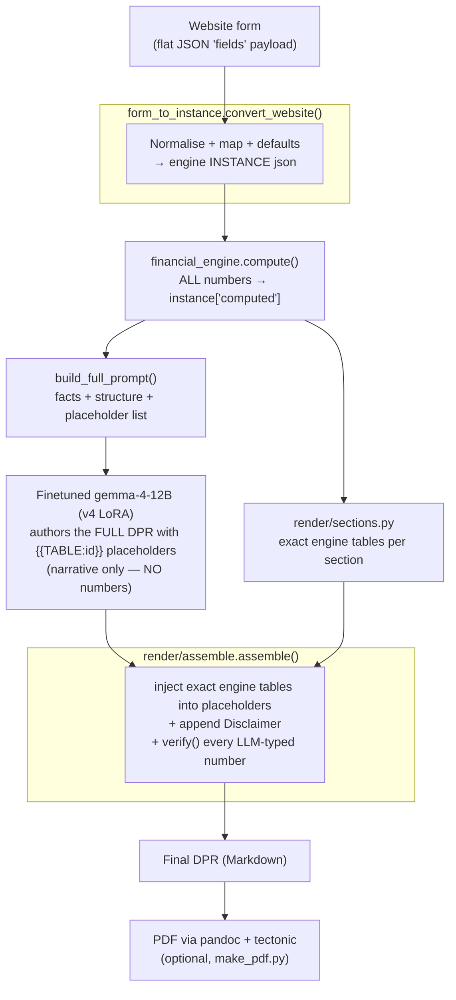

# DPR Generation Flow — from website form to finished report

This document traces a single DPR request end to end: the JSON payload the NAFPO
website form submits, every transformation it goes through, and the final report
that comes out — plus exactly what each stage needs to run.

> **The one rule that governs everything:** the pipeline runs in **two lanes**.
> A deterministic Python **engine owns every number**; the **LLM owns only the
> prose**. The two are stitched together at the end, and every figure the model
> typed is verified against the engine before the report is released. No
> LLM-invented number ever reaches the final DPR.

---

## 1. The big picture



The engine output is byte-for-byte identical no matter which model writes the
prose; swapping models only changes §2's wording.

---

## 2. Stage by stage

### Stage 0 — Input: the website payload

The form (`https://academy.nafpo.in/FPO-Document-Builder.html`, DPR section) posts
a **flat** object of `fields`. Canonical schema:
[`docs/schema/FPO-Document-Builder-schema.json`](schema/FPO-Document-Builder-schema.json).

```jsonc
{ "document_type": "dpr",
  "fields": {
    "fpoName": "...", "registrationNo": "...", "location": "...", "year": 2020,
    "members": 1800, "turnover": "Rs 2.6 crore", "crops": "...", "ceoName": "...",
    "mobile": "...", "email": "...",
    "businessLine": "Oil Extraction",           // one of 12 lines
    "commodity": "Groundnut / Oilseeds",         // dropdown; drives the product
    "commodityOther": "",                        // used when commodity == "Other"
    "siteAddress": "...",
    "machinery": [{"item":"Expeller","cost_inr":420000}, ...],   // editable table
    "landStatus": "Owned" | "Leased/Rented", "monthlyRent": 0,
    "civilCost": 600000, "otherFixedAssets": 200000,
    "capacity": 237.5, "workingDays": 300, "buyers": "...",
    "salePrice": 140, "priceEscalation": 5,
    "manpower": [{"role":"Operator","count":3,"monthly_wage_inr":13000}, ...],
    "rmcost": {"mode":"unit"|"pct","value":35},
    "electricityCost": 22000, "ownFunds": 400000, "jobs": "11",
    "schemeChoice": "Yes" | "No" | "Not sure",
    "schemeName": "PMFME" | "AIF" | "MIDH" | "Others",
    "loan": {"interest_pct":11,"tenure_months":84,"moratorium_months":12}
} }
```

The form does **not** run any financials — it only collects inputs. All numbers
are computed in the next stage.

### Stage 1 — Convert: payload → engine instance

**Code:** `convert_website()` in [`form_to_instance.py`](../dpr/form_to_instance.py)
(a top-level `convert()` dispatches: website payload → `convert_website`; internal
nested payload → `convert_nested`, used only for dataset generation).

It loads the business line's **template**
([`data/templates/<line>.json`](../data/templates)) for technical norms, then maps the
form fields onto an engine **instance** with four blocks: `meta`, `narrative`,
`inputs`, `config`. Key mappings:

| Form field(s) | → Instance | Rule |
|---|---|---|
| `businessLine` | template + `meta` | one of the 12 lines → template stem (`BL_TO_TEMPLATE`) |
| `commodity` / `commodityOther` | `meta.commodity`, report title | For **Oil/Juice/Spice** the product name is derived from the commodity (`"{c} Oil"`, `"{c} Juice"`, `"{c}"`) and the LLM writes the product intro. Other lines use the template's fixed product. |
| `machinery[]` | `inputs.capex.machinery_inr` | **sum** of `cost_inr` across rows; blank → template machinery |
| `civilCost` | `inputs.capex.civil_construction_lakh` | **always capitalised** (÷1e5), any land status |
| `otherFixedAssets` | `inputs.capex.misc_fixed_assets_lakh` | ÷1e5; blank → template default |
| `landStatus` / `monthlyRent` | `inputs.land_status`, `rent_per_month_inr` | leased → rent charged to P&L (still capitalises civil) |
| `capacity` / `workingDays` | `inputs.capacity.*` | output-throughput model in the line's own unit; **service lines (CHC, Warehouse) treat capacity as annual** |
| `salePrice`, `rmcost{mode,value}` | `inputs.prices.*` | `unit`→per-unit rate; `pct`→fraction of revenue; blank → line default |
| `manpower[]` | `config.labour_wage_table` / `staff_wage_table` | Worker/Labour/Operator → **labour (COGS)**; supervisor/sales/security/other → **staff (admin)** |
| `loan{...}` | `config.interest_rate_pct`, `loan_tenor_months`, `moratorium_months` | tenure ≤ 12 → default **60**; moratorium clamped to `tenure−1` |
| `priceEscalation` | `config.annual_price_escalation_pct` | default 5 |
| `electricityCost` | `config.electricity_monthly_inr` | power cost = value **× 12** |
| `schemeChoice` / `schemeName` | `inputs.scheme.choice` | Yes+name → `pmfme`/`aif`/`midh`; **Others → self-funded + a note**; No/Not sure → self-funded |
| `ownFunds` | `inputs.own_equity_committed_lakh` | ÷1e5 |
| `fpoName, registrationNo, ceoName, mobile, email, siteAddress, location, ...` | `narrative.*` | applicant/contact block shown in §1; context for the LLM |

**Defensive by design:** `convert_website()` never throws on bad or blank input.
A numeric parser (`_num`) tolerates strings, commas, `Rs`/`%`, and blanks; every
missing field falls back to a **calibrated per-line default** (`LINE_DEFAULTS`), so
a viable instance is always produced even from a near-empty form.

### Stage 2 — Compute: fill every number

**Code:** `compute()` in [`engine/financial_engine.py`](../dpr/engine/financial_engine.py)
(+ scheme norms in [`engine/scheme_norms.py`](../dpr/engine/scheme_norms.py)).

Runs the full financial model over a **5-year** horizon and writes
`instance["computed"]`:

- production & sales, raw-material cost (per-unit or % of revenue)
- fixed capital (machinery + **civil, always** + misc), WDV depreciation
- means of finance by scheme (subsidy / term loan / WC bank / FPO promoter equity)
- term-loan schedule with moratorium; traditional working capital (margin + CC split)
- P&L (tax on **full PBT**, no threshold), break-even, balance sheet, cash flow
- **DSCR** (annual + average)

The engine asserts **means of finance == total project cost** before returning.
Financial formulas are documented in
[`docs/FINANCIAL_ENGINE.md`](FINANCIAL_ENGINE.md).

### Stage 3 — Author: the LLM writes the prose (Option B)

**Code:** `build_full_prompt()` in [`authoring.py`](../dpr/authoring.py);
inference driver in [`eval_ft.py`](../training/eval_ft.py).

The prompt gives the model the product facts, the section structure, and the exact
list of `{{TABLE:id}}` placeholders it must place. The **finetuned gemma-4-12B
(v4 LoRA adapter)** authors the **entire** DPR — headings + §2 narrative + all the
placeholders — and is told to write **no numbers** (every figure lives in a table).

### Stage 4 — Assemble + verify

**Code:** `assemble()` in [`render/assemble.py`](../dpr/render/assemble.py); section bodies
from [`render/sections.py`](../dpr/render/sections.py).

1. **Inject** — each `{{TABLE:id}}` is replaced by the engine's exact rendered
   section body (§1 summary, §3 presumptions, §4 process flow, §5.x economics, §6
   limitations). §2 is the model's own narrative.
2. **Disclaimer** — the fixed Avataar AI / NAFPO disclaimer is appended at the end.
3. **Verify** — `verify()` scans every financial number the model typed in its own
   prose and flags any that doesn't match an engine value (within rounding). A clean
   report has `ok=True`, `number_issues=[]`, and every placeholder placed exactly once.

If verification fails, the doc is rejected (training) or flagged for repair
(inference) — a bad number never ships.

### Stage 5 — Output

- **Markdown** — the finished DPR string (the primary artifact).
- **PDF** *(optional)* — [`make_pdf.py`](../dpr/make_pdf.py) renders
  Markdown → PDF with **pandoc + tectonic** using the styles in [`pdf/`](pdf)
  (TOC after the project summary, TikZ process-flow chart, booktabs tables).

---

## 3. What each stage needs

| Stage | Needs |
|---|---|
| Convert | Python venv; the 12 templates in `data/templates/`; the schema file |
| Compute | `engine/financial_engine.py` + `engine/scheme_norms.py` (pure Python, no GPU) |
| Author | the base model `google/gemma-4-12B-it` + the **v4 LoRA adapter** (`models/…`); a **GPU** for inference; HF token if the base is gated |
| Assemble/verify | `render/sections.py` + `render/assemble.py` (pure Python) |
| PDF | `pandoc` (bundled via pypandoc) + `tectonic` (bundled LaTeX; cache in `.tectonic-home`) |

**Only Stage 3 needs a GPU / the model.** Everything else is deterministic Python —
so the numbers, tables, and verification run anywhere, instantly, and are fully
reproducible.

---

## 4. The two payload formats (why there are two `convert` paths)

| Format | Shape | Used by | Handler |
|---|---|---|---|
| **Website (flat)** | `{fields: {...}}` | production — the real NAFPO form | `convert_website()` |
| **Internal (nested)** | `stage0_basic_info` / `stage1_land_business` / … | dataset generation only (`gpt_gen_payloads.py`, `gen_dataset.py`) | `convert_nested()` |

Both produce the **same** engine instance shape and flow through the identical
compute → author → assemble path. The dispatcher `convert()` routes on the presence
of `stage0_basic_info`. See [README.md](../README.md) for the training workflow.
